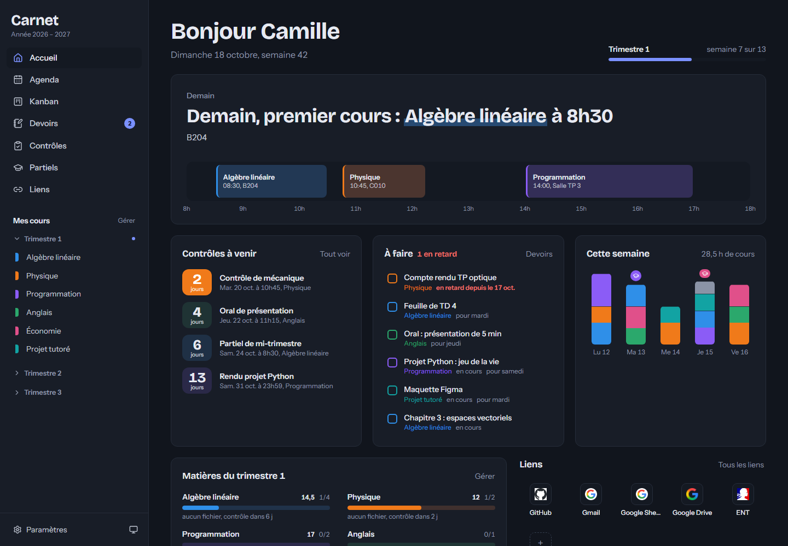

# Carnet

Mon hub de cours pour l'année : emploi du temps, fichiers de cours, devoirs, contrôles, partiels et kanban au même endroit.



## Fonctionnalités

- **Accueil** : la journée sur un ruban horaire, les contrôles à venir, les devoirs urgents, la charge de la semaine et la progression par matière.
- **Cours** : les matières rangées par trimestre, chacune avec sa couleur, ses fichiers, son suivi et ses liens.
- **Fichiers** : PDF, PPTX et DOCX lisibles directement dans l'app (les PPTX et DOCX sont convertis en PDF par LibreOffice).
- **Agenda** : import de l'emploi du temps en .ics (par lien, synchronisé automatiquement, ou par fichier), vues semaine et mois.
- **Devoirs** : exercices et rendus classés par échéance, liés au fichier de l'énoncé.
- **Contrôles et partiels** : compte à rebours, notes et moyennes pondérées par les coefficients.
- **Kanban** : chapitres, devoirs et révisions, de « à faire » à « fait ».
- **Liens** : GitHub, mail, Google Sheets et autres raccourcis.

Thème clair et sombre, utilisable sur téléphone.

## Lancer en local

Prérequis : Node.js 24 ou plus récent. LibreOffice est optionnel (il sert à afficher les PPTX et DOCX).

```bash
npm install
```

```bash
npm run dev
```

L'app est ensuite sur http://localhost:3000.

Pour l'essayer avec des données fictives :

```bash
npm run demo
```

## Données

Tout est stocké en local dans `data/` : la base SQLite et les fichiers importés. Ce dossier n'est pas versionné. Son emplacement se change avec la variable d'environnement `DATA_DIR`.

## Déploiement

L'app est auto-hébergée sur mon home lab.

L'app n'a pas de connexion par mot de passe : elle reste sur le réseau local ou derrière un accès protégé (VPN ou reverse proxy avec authentification).

## Réalisation

Le code a été développé avec [Claude Code](https://claude.com/claude-code), comme mon portfolio. La mise en place et le déploiement sur le home lab sont faits à la main, sans IA.

## Stack

Next.js 16, React 19, Tailwind CSS 4, SQLite (`node:sqlite`), node-ical, dnd-kit, date-fns.
